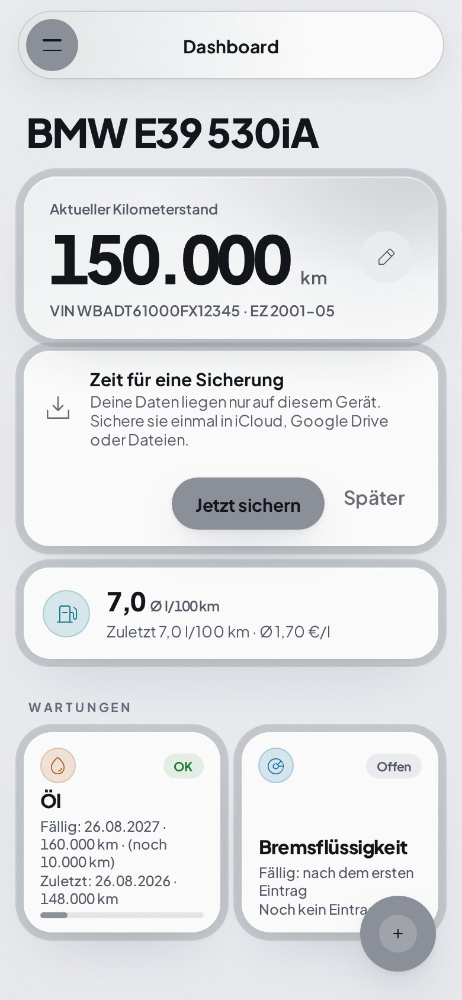
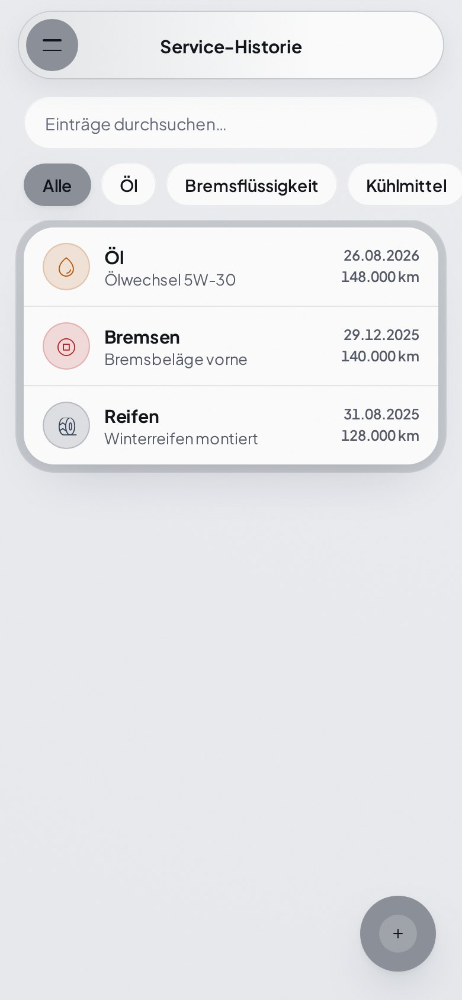
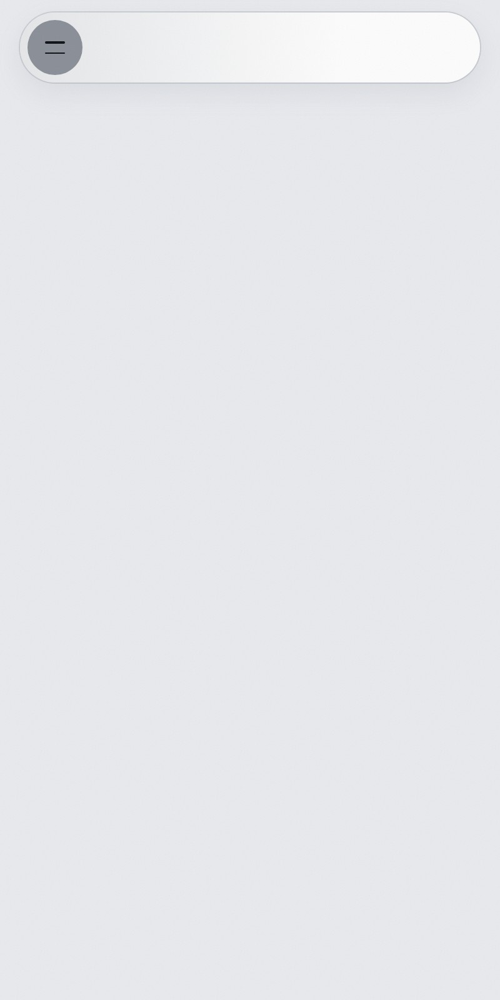
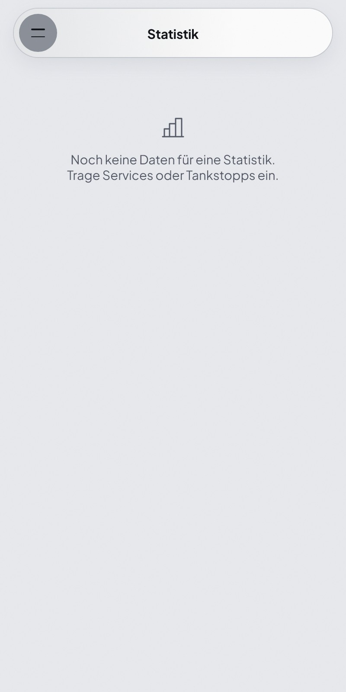

<div align="center">

# 🚗 Service-Tracker

### Maintenance, costs, and fuel log for your car – offline, no account

Keep track of due maintenance, analyze costs and consumption, share your service book – as an installable web app.


<a href="https://github.com/phil07/carservicetracker/actions/workflows/test.yml"></a>

[Deutsch](README.md) · **English**

[Features](#-features) · [Quick start](#-quick-start) · [Project structure](#-project-structure) · [Deployment](#-deployment) · [Privacy](#-privacy)

<br/>

<table>
<tr>
<td align="center"><br/><sub><b>Dashboard</b></sub></td>
<td align="center"><br/><sub><b>Service history</b></sub></td>
<td align="center"><br/><sub><b>Fuel log</b></sub></td>
<td align="center"><br/><sub><b>Statistics</b></sub></td>
</tr>
</table>

</div>

<br/>

## 🔧 Why Service-Tracker?

Built for a BMW E39, usable for **any vehicle**. The app runs entirely in the browser, works offline, and stores data locally. Syncing through your own Google Drive is optional – there is no developer server that sees your data.

| | |
| --- | --- |
| 📴 **Offline first** | Service worker and local storage, usable in the workshop without reception |
| 🔒 **Your data stays with you** | Local in the browser; Drive sync only in the hidden app folder of your account |
| 🔔 **Never forget** | Reminders for due maintenance and your own deadlines |
| ⚡ **No build** | Plain HTML, CSS, and JavaScript – a static server is enough |

## ✨ Features

| Feature | Description |
| --- | --- |
| **Dashboard** | Due maintenance per vehicle: OK, due soon, overdue |
| **Maintenance history** | Entries with costs, mileage, workshop, notes, and photos, with search and category filter |
| **Fuel log** | Record refuels, consumption in l/100 km and price per liter |
| **Statistics** | Total costs, per year, per 100 km, and by category |
| **Custom deadlines** | E.g. insurance or inspection, one-off or recurring |
| **Multiple vehicles** | Paint color as accent color, theme light, dark, or automatic |
| **Reminders** | Notification on open and app badge, all handled locally without a server |
| **Digital service book** | Public snapshot of the vehicle (without costs, notes, and fuel log) at `/s/<id>`, shareable by link |
| **Backup** | Backup file, in-browser safety copy, optional Google Drive sync |

## 🚀 Quick start

No dependencies, no build. Serve the folder with a local HTTP server:

```bash
python -m http.server 8765
```

Then open `http://localhost:8765`. Service workers and PWA installation require HTTP(S). The digital service book and Google sign-in run through the worker (see [Deployment](#-deployment)).

**Install as an app:** use *Install* or *Add to Home Screen* in the browser menu.

## 🧱 Project structure

| File | Purpose |
| --- | --- |
| `index.html`, `app.js`, `style.css` | UI and core logic |
| `extras.js`, `photos.js`, `reminders.js` | Deadlines and notes, photos (IndexedDB), reminders |
| `sync.js` | Google Drive sync (scope `drive.appdata`) |
| `book.js`, `scheckheft.*` | Digital service book: publishing and the public view |
| `worker.js`, `wrangler.jsonc` | Cloudflare Worker: serves the app, API for the service book and Google sign-in |
| `sw.js`, `version.js`, `manifest.json` | Offline cache, version number, PWA manifest |
| `datenschutz.html`, `impressum.html`, `legal.*` | Legal pages |
| `assets/` | Fonts and QR-code library |
| `docs/` | Setup guides (German) and screenshots |
| `tests/`, `package.json` | Unit and browser tests |

## ☁️ Deployment

The app is served as a Cloudflare Worker with static assets:

```bash
npx wrangler deploy
```

| Topic | Guide |
| --- | --- |
| Digital service book (KV storage) | [docs/scheckheft-setup.md](docs/scheckheft-setup.md) |
| Google Drive sync (OAuth client) | [docs/google-drive-sync.md](docs/google-drive-sync.md) |

## 🧪 Tests

```bash
npm test                # unit tests (fast, no browser)
npm install             # once: playwright-core
npm run test:e2e        # browser tests against the real app (needs Chromium)
```

The unit tests cover data validation and import, date math, service status, fuel consumption, VIN decoding, the backup reminder, the Drive merge logic, and the Cloudflare worker (booklet API, keys, photos, Google sign-in). The browser tests start a local server, block the network, and cover menu, history, adding and deleting entries, fuel log, and backup export/import. Both run in GitHub Actions on every push to `main`.

## 🔐 Privacy

Vehicle data stays in the browser until you enable Drive sync or the service book yourself. Drive sync uses the hidden app folder in your own account; there is no developer server with access to your data. The service book publishes only what you explicitly share. **Back up your data regularly**, because clearing browser data removes it.

## 🤝 Contributing

- Only the `main` branch exists; commit directly to it, no pull requests.
- On every push that changes app files (`index.html`, `app.js`, `style.css`, `sw.js`, `manifest.json`), increase `APP_VERSION` in `version.js` by one. Installed apps use it to detect the new build.
