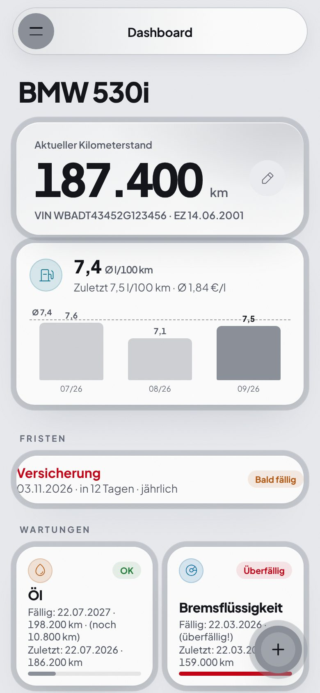
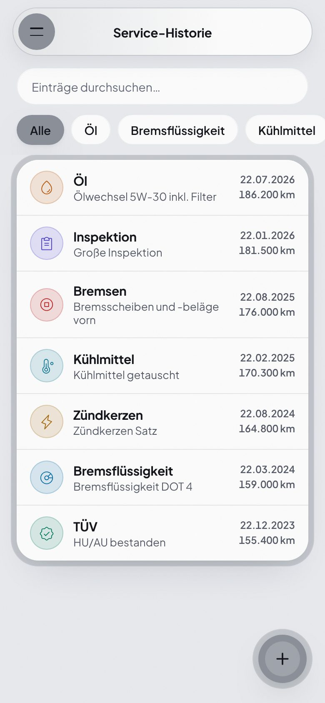
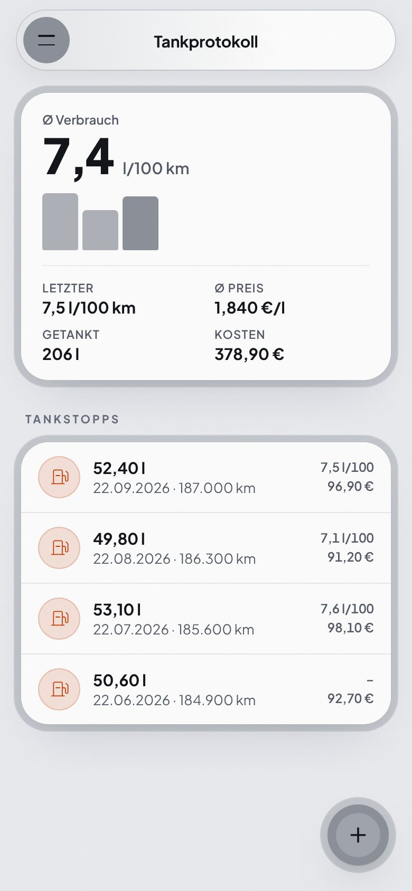
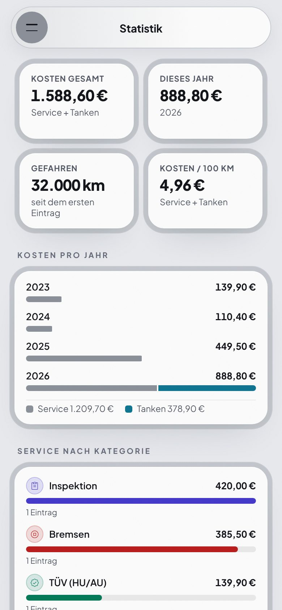

<div align="center">

# 🚗 Service-Tracker

### Wartung, Kosten und Tankbuch für dein Auto – offline, ohne Konto

Fällige Wartungen im Blick, Kosten und Verbrauch auswerten, Scheckheft teilen – als installierbare Web-App.


**Deutsch** · [English](README.en.md)

[Funktionen](#-funktionen) · [Schnellstart](#-schnellstart) · [Projektstruktur](#-projektstruktur) · [Deployment](#-deployment) · [Datenschutz](#-datenschutz)

<br/>

<table>
<tr>
<td align="center"><br/><sub><b>Dashboard</b></sub></td>
<td align="center"><br/><sub><b>Service-Historie</b></sub></td>
<td align="center"><br/><sub><b>Tankbuch</b></sub></td>
<td align="center"><br/><sub><b>Statistik</b></sub></td>
</tr>
</table>

</div>

<br/>

## 🔧 Warum Service-Tracker?

Entstanden für einen BMW E39, nutzbar für **beliebige Fahrzeuge**. Die App läuft vollständig im Browser, funktioniert offline und speichert Daten lokal. Ein Abgleich über den eigenen Google Drive ist optional – es gibt keinen Server des Entwicklers, der deine Daten sieht.

| | |
| --- | --- |
| 📴 **Offline zuerst** | Service Worker und lokale Speicherung, auch in der Werkstatt ohne Empfang nutzbar |
| 🔒 **Deine Daten bleiben bei dir** | Lokal im Browser; Drive-Abgleich nur im versteckten App-Ordner deines Kontos |
| 🔔 **Nichts vergessen** | Erinnerungen an fällige Wartungen und eigene Fristen |
| ⚡ **Ohne Build** | Reines HTML, CSS und JavaScript – ein statischer Server genügt |

## ✨ Funktionen

| Funktion | Beschreibung |
| --- | --- |
| **Dashboard** | Fällige Wartungen je Fahrzeug: OK, bald fällig, überfällig |
| **Wartungshistorie** | Einträge mit Kosten, Kilometerstand, Werkstatt, Notizen und Fotos, mit Suche und Kategoriefilter |
| **Tankbuch** | Tankvorgänge erfassen, Verbrauch in l/100 km und Preis je Liter |
| **Statistik** | Kosten gesamt, pro Jahr, pro 100 km und nach Kategorie |
| **Eigene Fristen** | Z. B. Versicherung oder TÜV, einmalig oder wiederkehrend |
| **Mehrere Fahrzeuge** | Lackfarbe als Akzentfarbe, Design hell, dunkel oder automatisch |
| **Erinnerungen** | Benachrichtigung beim Öffnen und Symbol-Zähler, alles lokal ohne Server |
| **Digitales Scheckheft** | Öffentliche Momentaufnahme des Fahrzeugs (ohne Kosten, Notizen und Tankbuch) unter `/s/<id>`, per Link teilbar |
| **Sicherung** | Backup-Datei, Sicherheitskopie im Browser, optionaler Google-Drive-Abgleich |

## 🚀 Schnellstart

Keine Abhängigkeiten, kein Build. Ordner über einen lokalen HTTP-Server ausliefern:

```bash
python -m http.server 8765
```

Anschließend `http://localhost:8765` öffnen. Service Worker und PWA-Installation benötigen HTTP(S). Das digitale Scheckheft und der Google-Login laufen über den Worker (siehe [Deployment](#-deployment)).

**Als App installieren:** im Browser-Menü *Installieren* bzw. *Zum Startbildschirm hinzufügen* wählen.

## 🧱 Projektstruktur

| Datei | Zweck |
| --- | --- |
| `index.html`, `app.js`, `style.css` | Oberfläche und Kernlogik |
| `extras.js`, `photos.js`, `reminders.js` | Fristen und Notizen, Fotos (IndexedDB), Erinnerungen |
| `sync.js` | Abgleich über Google Drive (Scope `drive.appdata`) |
| `book.js`, `scheckheft.*` | Digitales Scheckheft: Veröffentlichen und öffentliche Ansicht |
| `worker.js`, `wrangler.jsonc` | Cloudflare-Worker: liefert die App aus, API für Scheckheft und Google-Login |
| `sw.js`, `version.js`, `manifest.json` | Offline-Cache, Versionsnummer, PWA-Manifest |
| `datenschutz.html`, `impressum.html`, `legal.*` | Rechtliche Seiten |
| `assets/` | Schriften und QR-Code-Bibliothek |
| `docs/` | Einrichtungsanleitungen und Screenshots |

## ☁️ Deployment

Die App wird als Cloudflare Worker mit statischen Assets ausgeliefert:

```bash
npx wrangler deploy
```

| Thema | Anleitung |
| --- | --- |
| Digitales Scheckheft (KV-Speicher) | [docs/scheckheft-setup.md](docs/scheckheft-setup.md) |
| Google-Drive-Abgleich (OAuth-Client) | [docs/google-drive-sync.md](docs/google-drive-sync.md) |

## 🔐 Datenschutz

Fahrzeugdaten bleiben im Browser, bis du den Drive-Abgleich oder das Scheckheft selbst aktivierst. Der Drive-Abgleich nutzt den versteckten App-Ordner im eigenen Konto; es gibt keinen Server des Entwicklers mit Zugriff auf die Daten. Das Scheckheft veröffentlicht nur, was du ausdrücklich teilst. **Sichere deine Daten regelmäßig**, denn das Löschen von Browserdaten entfernt sie.

## 🤝 Mitarbeiten

- Nur der Branch `main` existiert; direkt dorthin committen, keine Pull Requests.
- Bei jedem Push, der App-Dateien ändert (`index.html`, `app.js`, `style.css`, `sw.js`, `manifest.json`), `APP_VERSION` in `version.js` um eins erhöhen. Daran erkennen installierte Apps den neuen Stand.
